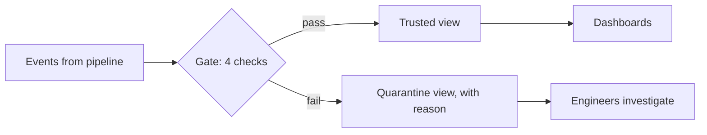
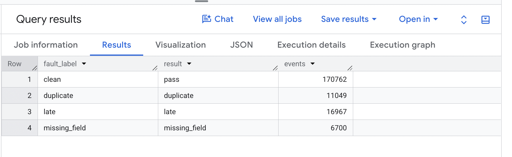
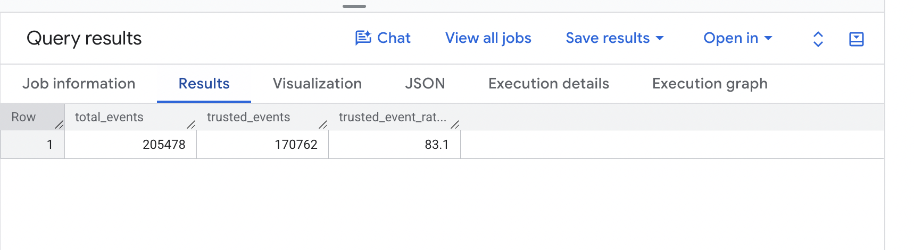
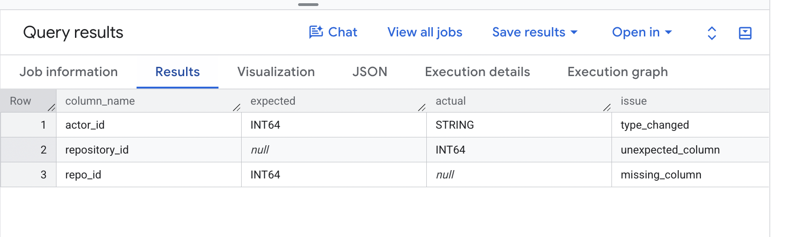
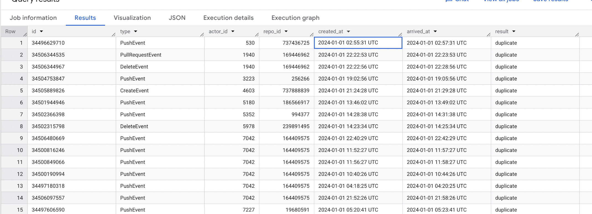

# Telemetry Data-Quality Gate

A checkpoint that tests every event before it reaches a dashboard, plus one metric that says how much of the data can be trusted.

**Dashboard:** `https://datastudio.google.com/reporting/d792e8d5-4ffb-4277-a79c-923650a505e9` | **Live page:** https://claude.ai/artifact/VgHctVZjK1XqXhFeMxCyNh 

**Dashboard img:** 

## The problem

Product teams make decisions from telemetry dashboards: "crashes rose after the last release, so roll it back." But the events behind those numbers can arrive late, arrive twice, miss key fields, or change format after a release. When that happens the dashboard is wrong and nobody can tell. The first question an engineer asks about any spike is "is it real, or is the data broken?", and today that question costs hours of manual digging.

**This project answers "can I trust this number?" with evidence, before the dashboard shows it.**

| Who | How they use it |
|---|---|
| PMs and analysts | Read the Trusted Event Rate before presenting a number |
| Engineers | Read the quarantine view to find the cause of broken data |
| Data owners | Use the failure breakdown to decide which source to fix first |

## How it works

Every event is labelled by the **first** check it fails. Nothing is deleted, so engineers keep the evidence.

| Check | Rule | Why it matters | On fail |
|---|---|---|---|
| Completeness | Device, repo and time fields are present | Events missing a field cannot be tied to a release, so breakdowns add up to less than the total | Quarantine, tell the source team which field |
| Freshness | Arrives within 15 minutes of when it happened | Late events make today's number look low, then it rises and someone raises a false alarm | Hold, add to the count when it lands |
| Uniqueness | Each event ID appears once | Retries double-count events and inflate totals | Keep the first copy, log the rest |
| Schema stability | Columns match the agreed contract (batch-level) | A release that renames or retypes a field can silently break dashboards, and no single row shows it | Quarantine the batch, alert the owner |

The order is a design choice: an event you cannot identify cannot be reliably checked for lateness or duplication, so completeness goes first.

**North-star metric:** Trusted Event Rate = events passing all checks / all events. **Target:** 97%. **Guardrail:** the gate adds no more than 10 minutes to a dashboard refresh.

## Data and method

- **Source:** GitHub Archive (public dataset in BigQuery), 1 Jan 2024, a 5% sample of 205,478 events after fault injection. It stands in for telemetry. **It is not from a live product.**
- **Faults were injected on purpose** and recorded in an answer key, so I could test whether the gate catches them: about 3.5% missing fields, about 9% late arrivals (20 to 60 minutes), duplicates of about 6.5% of clean rows, and a simulated release that retyped one column and renamed another.
- **Tools:** BigQuery (free sandbox), SQL, Looker Studio.

## Results

| Planted fault | Events | Caught by gate |
|---|---|---|
| Late arrivals | 16,967 | 16,967 |
| Duplicates | 11,049 | 11,049 |
| Missing fields | 6,700 | 6,700 |
| Schema changes (simulated release) | 3 | 3 |

No clean event was flagged (zero false alarms).

**Trusted Event Rate: 83.1%** (170,762 of 205,478 events). The other 34,716 were held back:

| Cause | Events | Share of held back |
|---|---|---|
| Late | 16,967 | 49% |
| Duplicate | 11,049 | 32% |
| Missing field | 6,700 | 19% |

**What I would fix first: freshness.** It is nearly half of what was held back, so it moves the metric most. Halving it would lift the Trusted Event Rate by about 4 points. On real data I would confirm this before acting; here the fault rates were set by me.

The schema check compared a simulated release against the saved contract and flagged 3 rows: `actor_id` retyped, `repo_id` missing, `repository_id` unexpected. A rename shows as two rows because SQL cannot know they are the same column.

## Limits

- **I wrote both the faults and the checks.** Catching 100% shows the checks work as designed. It does not show they would catch every fault in real telemetry.
- **The delay chart is simulated.** Normal events were given 0 to 5 minutes of delay and late events 20 to 60, so the empty 6 to 15 minute bucket is an artifact of my setup, not a finding. On real data I would pick the freshness threshold from the actual spread of delays.
- Random sampling means counts differ slightly on each run. The figures above are from one run, and screenshots are in `screenshots/`.
- The live dashboard reads sandbox tables that expire after 60 days. If it goes blank, the screenshots and PDF in this repo show the same results, and rerunning the SQL files recreates the tables.

## Repo contents

| File | What it does |
|---|---|
| `sql/01_profile_source.sql` | Profiles the source data |
| `sql/02_create_sample.sql` | Takes a 5% sample |
| `sql/03_inject_faults.sql` | Plants missing fields and late arrivals, with an answer key |
| `sql/04_add_duplicates.sql` | Plants duplicates |
| `sql/05_gate_checks.sql` | The gate: labels every event |
| `sql/06_verify_against_answer_key.sql` | Compares gate results with the answer key |
| `sql/07_trusted_event_rate.sql` | Computes the north-star metric |
| `sql/08_schema_contract.sql` | Saves the expected schema |
| `sql/09_simulate_drifted_release.sql` | Simulates a release that changes the schema |
| `sql/10_schema_drift_check.sql` | Compares a table with the contract |
| `sql/11_gate_views.sql` | Trusted and quarantine views |
| `sql/12_dashboard_views.sql` | Helper views for the dashboard |
| `sql/13_investigate_quarantine.sql` | How an engineer inspects held-back events |
| `screenshots/` | Results and dashboard screenshots |

## Run it yourself

1. Open BigQuery (the free sandbox works, no card needed) and create a dataset named `dq`.
2. Replace `YOUR_PROJECT` in each file with your project ID.
3. Run the files in `sql/` in numeric order, one at a time.

## Why I built it

At Deloitte I built a real-time API data integration with data-quality checks that cut manual reconciliation from 2 days to 10 minutes. This project applies the same thinking to telemetry-style data, and shows how I define a metric, test it, and decide what to fix first.

*Manish Suyal*
